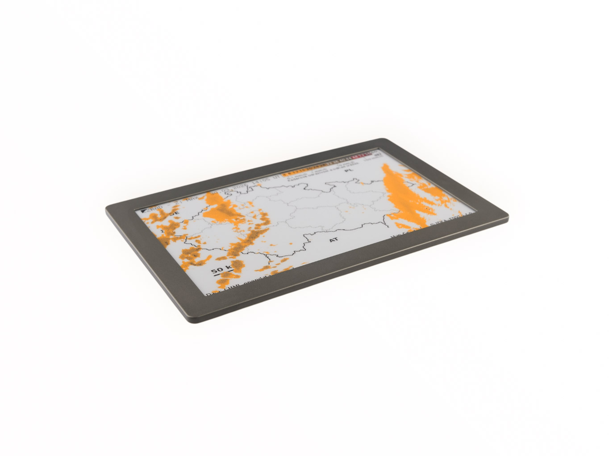

[🇬🇧 English version](README.md)



# LaskaKit ESPink-Frame-7.x — úsporná deska s ESP32-S3 pro velké 7,5" a 7,3" ePaper displeje

**ESPink-Frame-7.x** je univerzální a velmi úsporná deska s **ESP32-S3** pro velké ePaper displeje s rozlišením 800 × 480 px. Ovládá černobílý i čtyřbarevný **7,5"** displej a šestibarevný **7,3" Spectra 6**. Je srdcem stavebnice [LaskaKit Live-7.x-Pro](https://www.laskakit.cz/laskakit-live-7-x-pro-e-paper-stavebnice-s-wifi-pro---zivy-obraz-/) — Wi-Fi fotorámečku / dashboardu pro službu [Živý Obraz](https://zivyobraz.eu/) — ale stejně dobře poslouží i ve tvých vlastních projektech.

Deska je navržená na dlouhý provoz z akumulátoru: displej, čidla, μŠup konektory i microSD karta jsou napájené ze samostatného stabilizátoru, který před hlubokým spánkem vypneš jediným GPIO. Akumulátor se nabíjí přímo z USB-C, přes které desku zároveň programuješ díky převodníku CH9102F.

---

## Hlavní vlastnosti

- **ESP32-S3-WROOM-1U-N16R8** — 16 MB Flash, 8 MB PSRAM, Wi-Fi a Bluetooth LE, **U.FL konektor pro externí anténu** (deska je schovaná za velkým displejem, externí anténa proto výrazně zlepší dosah)
- **Dva konektory pro displej:**
  - 24pinový FPC pro 7,5" displeje (GDEY075T7, GDEM075F52)
  - 50pinový FPC pro 7,3" Spectra 6 (GDEP073E01)
- **Spínané napájení periferií** — GPIO47 spíná větev `VSENSOR` (stabilizátor RT9080), ze které je napájený ePaper, μŠup konektory, osazené SHT40, microSD karta i rozšiřující lišta
- **Nabíjení Li-Pol akumulátoru** z USB-C (TP4054, cca 0,56 A), konektor JST-PH 2.0, LED indikace nabíjení
- **Měření napětí akumulátoru** děličem na GPIO9
- **Vypínač** odpojující akumulátor
- **Osazené čidlo SHT40** (teplota a vlhkost)
- **μŠup konektory** — 1× I2C (kompatibilní s Adafruit Stemma QT / SparkFun Qwiic) a 1× SPI
- **Slot na microSD kartu** s detekcí vložení
- **3 uživatelská tlačítka** (UP / PUSH / DOWN) + RESET
- **Rozšiřující lišta 1×15** s volnými GPIO
- 4× distanční sloupek M2,5 pro uchycení

---

## Podporované displeje

| Displej | Úhlopříčka | Rozlišení | Barvy | Překreslení | Propojka `DISPLAY` |
|---|---|---|---|---|---|
| [Good Display GDEY075T7](https://www.laskakit.cz/good-display-gdey075t7-7-5--800x480-epaper-displej-grayscale/) | 7,5" | 800 × 480 | černobílý, 4 odstíny šedi | rychlé (cca 3,5 s), částečné překreslení | LEFT (0,44 Ω) |
| [Good Display GDEM075F52](https://www.laskakit.cz/good-display-gdem075f52-7-5--800x480-epaper-displej-4-barvy/) | 7,5" | 800 × 480 | černá, bílá, červená, žlutá | pomalé (cca 22 s) | rozpojeno (2,2 Ω, výchozí) |
| [Good Display GDEP073E01](https://www.laskakit.cz/good-display-gdep073e01-7-3--800x480-epaper-barevny-displej/) | 7,3" | 800 × 480 | Spectra 6 — černá, bílá, červená, žlutá, modrá, zelená | pomalé (cca 19 s) | RIGHT (0,1 Ω) |

> **Důležité:** pájecí propojka `DISPLAY` nastavuje snímací rezistor zvyšujícího měniče ePaperu. Nastav ji podle použitého displeje (viz tabulka výše a schéma).

---

## Specifikace

| Parametr | Hodnota |
|---|---|
| MCU | ESP32-S3 (ESP32-S3-WROOM-1U-N16R8), 16 MB Flash, 8 MB PSRAM |
| Bezdrátová komunikace | Wi-Fi 2,4 GHz, Bluetooth LE, externí anténa přes U.FL |
| Napájení | USB-C 5 V nebo 1článkový Li-Pol 3,7 V (JST-PH 2.0) |
| Nabíjení | TP4054, cca 0,56 A |
| Převodník USB–UART | CH9102F |
| Stabilizátory | 2× RT9080-33 (trvalých 3,3 V pro MCU, spínaných 3,3 V `VSENSOR` pro periferie) |
| Čidlo na desce | SHT40 (I2C, adresa 0x44) |
| Logické úrovně | 3,3 V |
| Revize HW | v1.2 |

---

## Zapojení pinů

### ePaper (standardní pro GxEPD2)

| Signál | GPIO |
|---|---|
| MOSI / SDI | 11 |
| CLK / SCK | 12 |
| CS | 10 |
| DC | 48 |
| RST | 45 |
| BUSY | 38 |
| Napájení periferií `VSENSOR` (HIGH = zapnuto) | 47 |

### I2C μŠup + osazené SHT40

| Signál | GPIO |
|---|---|
| SDA | 42 |
| SCL | 2 |

### SPI μŠup

| Signál | GPIO |
|---|---|
| CS | 46 |
| MOSI | 3 |
| CLK | 14 |
| MISO | 21 |

### microSD karta (sdílí SPI s ePaperem)

| Signál | GPIO |
|---|---|
| CS | 17 |
| MOSI | 11 |
| CLK | 12 |
| MISO | 13 |
| Detekce karty | 16 |

### Tlačítka (aktivní v LOW, externí pull-up 10k)

| Tlačítko | GPIO |
|---|---|
| UP | 39 |
| PUSH | 40 |
| DOWN | 41 |

> GPIO39–41 nejsou RTC GPIO, tlačítka proto **neumí probudit ESP32-S3 z hlubokého spánku**. Používej je, když deska běží, nebo ji probouzej časovačem.

### Napětí akumulátoru

| Signál | GPIO |
|---|---|
| Dělič 1 MΩ / 1,3 MΩ | 9 |

```cpp
float vBat = analogReadMilliVolts(9) * 1.769 / 1000.0; // napětí akumulátoru ve V
```

### Rozšiřující lišta JP1 (1×15, 2,54 mm)

| Pin | Signál | Pin | Signál |
|---|---|---|---|
| 1 | IO1 | 9 | IO15 |
| 2 | IO37 | 10 | IO7 |
| 3 | IO36 | 11 | IO6 |
| 4 | IO35 | 12 | IO5 |
| 5 | IO20 | 13 | IO4 |
| 6 | IO19 | 14 | GND |
| 7 | IO8 | 15 | VSENSOR (spínaných 3,3 V) |
| 8 | IO18 | | |

> IO35, IO36 a IO37 interně používá oktální PSRAM modulu N16R8 — **nepoužívej je**.

---

## Živý Obraz

Deska podporuje projekt [Živý Obraz](https://zivyobraz.eu/) — bez psaní kódu zobrazíš fotografie, kalendář (Google, Outlook, Apple), předpověď počasí, data z meteostanice nebo z chytré domácnosti.

1. Otevři [webový instalátor](https://zivyobraz.eu/?page=instalace).
2. Zvol desku **LaskaKit ESPink 2.x, 3.5 a 3.6** a typ svého displeje (GDEY075T7, GDEM075F52 nebo GDEP073E01).
3. Nahraj firmware, připoj se k Wi-Fi a postupuj podle [dokumentace](https://wiki.zivyobraz.eu/).

---

## Vzorové kódy

Příklady pro Arduino najdeš ve složce [SW](SW). Používají knihovnu [GxEPD2](https://github.com/ZinggJM/GxEPD2) — displej vybereš pomocí `#define DISP_...` na začátku programu.

| Příklad | Popis |
|---|---|
| [GxEPD2_SHT40](SW/GxEPD2_SHT40) | Teplota, vlhkost a napětí akumulátoru na displeji, pak hluboký spánek |
| [GDEP073E01_GxEPD2](SW/GDEP073E01_GxEPD2) | Šestibarevný displej Spectra 6 s knihovnou GxEPD2 |
| [GDEP073E01_ESP32](SW/GDEP073E01_ESP32) | Šestibarevný displej Spectra 6 s ovladačem od Good Display (obrázek z `image.h`) |
| [Buttons](SW/Buttons) | Čtení tlačítek UP / PUSH / DOWN |
| [I2C_test](SW/I2C_test) | Skenování I2C sběrnice |
| [SD_Test](SW/SD_Test) | Test microSD karty |

Nezapomeň před komunikací s displejem, čidly nebo SD kartou nastavit `GPIO47` do HIGH a před hlubokým spánkem do LOW.

---

## Obsah repozitáře

- [HW](HW) — schémata (PDF)
- [3D](3D) — 3D model desky (STEP, Fusion 360)
- [Production](Production) — výrobní data (Gerber, BOM, CPL)
- [SW](SW) — vzorové kódy
- [Version.md](Version.md) — historie revizí HW

---

## Kde koupit

- Deska: [LaskaKit ESPink-Frame-7.x e-Paper Board](https://www.laskakit.cz/laskakit-espink-frame-7-x-e-paper-board/)
- Kompletní stavebnice s displejem, akumulátorem, anténou a rámečkem: [LaskaKit Live-7.x-Pro](https://www.laskakit.cz/laskakit-live-7-x-pro-e-paper-stavebnice-s-wifi-pro---zivy-obraz-/)
- Čidla s μŠup konektorem: [SHT40](https://www.laskakit.cz/laskakit-sht40-senzor-teploty-a-vlhkosti-vzduchu/), [BME280](https://www.laskakit.cz/arduino-senzor-tlaku--teploty-a-vlhkosti-bme280/), [SCD41](https://www.laskakit.cz/laskakit-scd41-senzor-co2--teploty-a-vlhkosti-vzduchu/)
